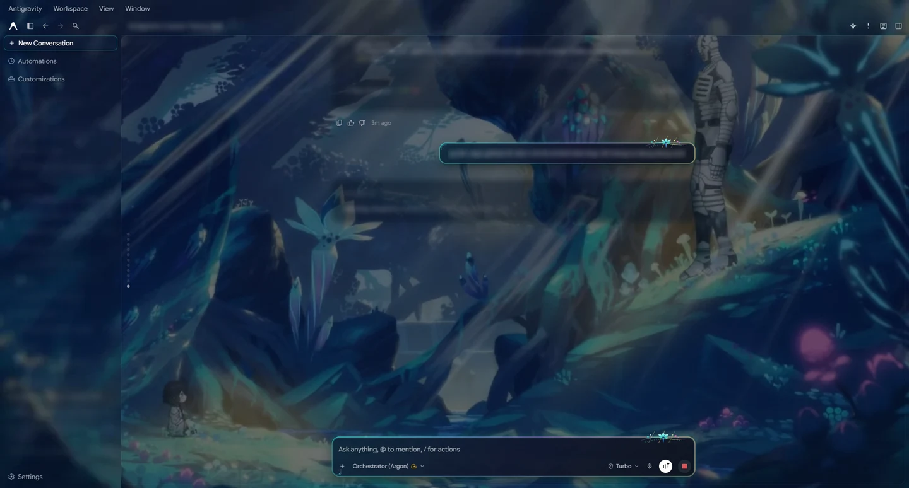
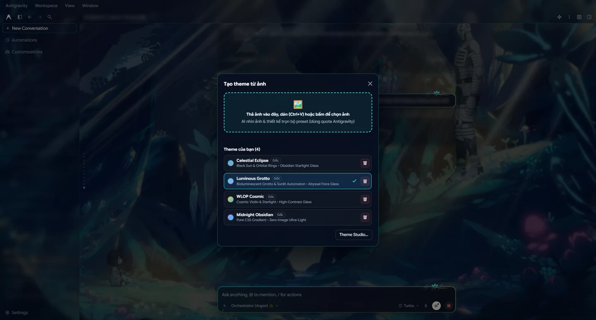
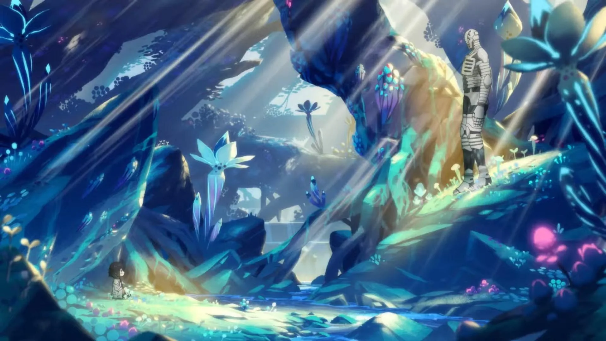
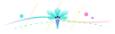
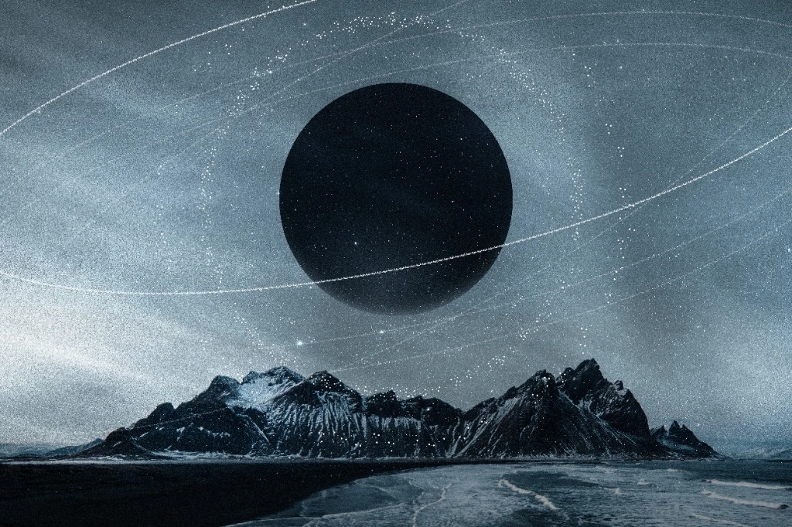

# Antigravity Custom Theme Skill

Turn any wallpaper, aesthetic mood, or color palette into a live, 60fps custom theme inside **Antigravity** — featuring a **Topbar ✨ One-Click AI Theme Generator** (powered by `agy` CLI using your own Antigravity login, zero API key required), a **Custom Theme Studio**, a standalone cross-platform CDP daemon, and a drop-in **AI Agent Skill** (`SKILL.md`).

> Drop, paste (`Ctrl+V`), or select any image from the topbar ✨ popup (or drop an image straight onto the ✨ button). Antigravity's `agy` CLI inspects the image, extracts a balanced Light/Dark glass palette, draws two bespoke SVG ornaments matching the artwork's motifs, applies the theme live, and persists it across restarts.

## Screenshots

### Live Antigravity UI (`Luminous Grotto` AI Preset)


### Topbar ✨ Quick Theme & AI Generator Popup


## Features

- **Topbar ✨ One-Click AI Theme Generator (`agy` CLI):**
  - Injects a sparkle (`✨`) button into Antigravity's topbar (`[data-testid="pane-titlebar-toolbar"]`).
  - Drag & drop an image directly onto the ✨ button or inside the popup, paste from clipboard (`Ctrl+V`), or browse from disk.
  - `daemon/theme_designer.js` invokes `agy -p --disable-slash-commands --json-schema ...` using your own Antigravity quota (no external API key needed) to design a cohesive glass palette (`primary`, `secondary`, `overlayRgb`, adaptive Light/Dark mode) plus two custom SVG flourishes (`cornerSvg` & `sticker`). Falls back gracefully to client-side palette extraction if `agy` is unavailable.
- **Manual Preset Deletion & 1-Click Cleanup (`🗑️`):**
  - Delete individual custom presets or hide built-in presets cleanly from either the topbar ✨ popup or **Theme Presets** in **Custom Theme Studio** (while always keeping at least one active preset).
  - Use **🗑️ Xóa tất cả tự tạo** to clear all generated presets in one click, or **↺ Khôi phục gốc** to restore hidden built-in presets.
  - Syncs across `localStorage`, `window.__AGY_INITIAL_CONFIG__`, and `theme_config.json` so deleted presets never reappear on reload.
- **Zero Live Blur Architecture (60fps Scroll):** Uses pre-baked offscreen canvas glass (`syncPrebakedGlass`) and gradient scrims instead of CSS `backdrop-filter: blur()`, preventing Electron/GPU scroll lag.
- **Unified L-Glass + Split-Browser Safe:** Automatically detects Antigravity's split embedded Chromium view (`data-has-browser-hole`) and cuts an `evenodd` `clip-path` window so embedded pages stay untouched and sharp.
- **Custom Theme Studio:** Switch presets, mix and match user chat bubbles & composer frame styles, upload custom wallpapers or **User / AI Agent circular avatars** (auto-compressed WebP), tune scrim dimming & pre-baked blur, and export/import JSON configs.
- **Cross-Platform Daemon (`daemon/theme_daemon.js`):** Windows, macOS, and Linux support using Node >= 22 built-in `WebSocket` (zero `npm install` needed).

## Included Presets

| Preset | Concept & Mood | Wallpaper | Chat Ornament |
| :--- | :--- | :---: | :---: |
| **Luminous Grotto** | Bioluminescent Grotto & Sunlit Automaton • Abyssal Flora Glass |  |  |
| **Celestial Eclipse** | Black Sun & Orbital Rings • Obsidian Starlight Glass |  |  |
| **WLOP Cosmic** | Cosmic Violin & Starlight • High-Contrast Glass |  |  |
| **Midnight Obsidian** | Pure CSS Gradient • Zero-Image Ultra-Light | *Pure CSS radial/linear gradient* | *Minimal clean* |

## Prerequisites

- **Antigravity** running with CDP debugging port active (`DevToolsActivePort`)
- **Node.js >= 22** (uses native `globalThis.WebSocket`, zero `npm install` needed)
- **Antigravity CLI (`agy`)** authenticated locally (optional; enables full AI preset & SVG ornament generation from the topbar popup)
- **Python 3.9+** (optional `Pillow` package recommended for auto-compressing large >2K wallpapers into WebP)

## Quick Start

### 1. Build the Runtime Payload

```bash
python scripts/build_payload.py
```

This resolves `themes/themes.json` + `themes/assets/*` and compiles them with `engine/core.js` into gitignored `dist/theme_payload.js`.

### 2. Install & Run the Daemon

**Windows (PowerShell):**

```powershell
powershell -ExecutionPolicy Bypass -File scripts/install-win.ps1
```

Creates a hidden launcher in your Windows Startup folder (`AntigravityCustomTheme.lnk`) without hardcoding paths and attaches silently. Pass `-NoStartup` if you only want to run it for the current session.

**macOS / Linux (Bash):**

```bash
bash scripts/install-unix.sh
```

- On **macOS**, installs a `~/Library/LaunchAgents/io.antigravity.custom-theme.plist` LaunchAgent.
- On **Linux**, installs a `systemd --user` service (or falls back to `nohup`).
- Use `bash scripts/install-unix.sh --foreground` to run interactively in your terminal, or `stop` / `status`.

> **Platform Testing Note:** Windows (`install-win.ps1`, CDP hot-reload, topbar AI generator, uninstall) has been verified live against Antigravity on Windows 11. macOS (`launchd`) and Linux (`systemd --user`) scripts are implemented and shell-syntax verified, and welcome community runtime feedback across macOS/Linux setups (you can override `DevToolsActivePort` location anytime via `AGY_PORT_FILE=/path/to/DevToolsActivePort`).

### 3. Verify Live via CDP

```bash
node scripts/verify_cdp.js
```

### 4. Uninstall Cleanly

```bash
node scripts/uninstall.js
```

Removes auto-start shortcuts/services, stops the background daemon, and immediately restores Antigravity's default styling on open windows.

## Use as an Antigravity Skill (`SKILL.md`)

Copy or clone this repository into either:

- **Global skill directory:** `~/.gemini/config/skills/antigravity-custom-theme/`
- **Workspace skill directory:** `.agents/skills/antigravity-custom-theme/`

Once installed, prompt your Antigravity agent with an image and aesthetic preference (e.g., *"Use `antigravity-custom-theme` to build me a dark emerald studio Ghibli theme from this image"*), or drop an image directly into the topbar ✨ popup.

## Repository Structure

```text
antigravity-custom-theme-skill/
├── SKILL.md                             # Agent skill definition & workflow
├── README.md
├── LICENSE                              # MIT
├── docs/
│   ├── preview_luminous_grotto.webp     # Live Antigravity UI screenshot
│   └── preview_topbar_popup.webp        # Topbar ✨ AI generator & manager screenshot
├── references/
│   └── theme-schema.md                  # themes.json schema & DOM notes
├── themes/
│   ├── themes.json                      # Built-in theme presets
│   └── assets/                          # Wallpapers & SVG stickers/corners
├── engine/
│   └── core.js                          # Core injection engine (Zero Live Blur, topbar popup, Studio UI)
├── daemon/
│   ├── theme_daemon.js                  # Cross-platform CDP injector & config persistence
│   └── theme_designer.js                # Headless agy CLI wrapper for AI preset & SVG generation
├── scripts/
│   ├── build_payload.py                 # Compiles themes.json + core.js -> dist/theme_payload.js
│   ├── install-win.ps1                  # Windows Startup launcher setup
│   ├── install-unix.sh                  # macOS LaunchAgent / Linux systemd user setup
│   ├── uninstall.js                     # Clean cross-platform removal
│   └── verify_cdp.js                    # Live CDP diagnostic & assertion check
└── dist/                                # Gitignored compiled runtime output
```

## License

MIT
